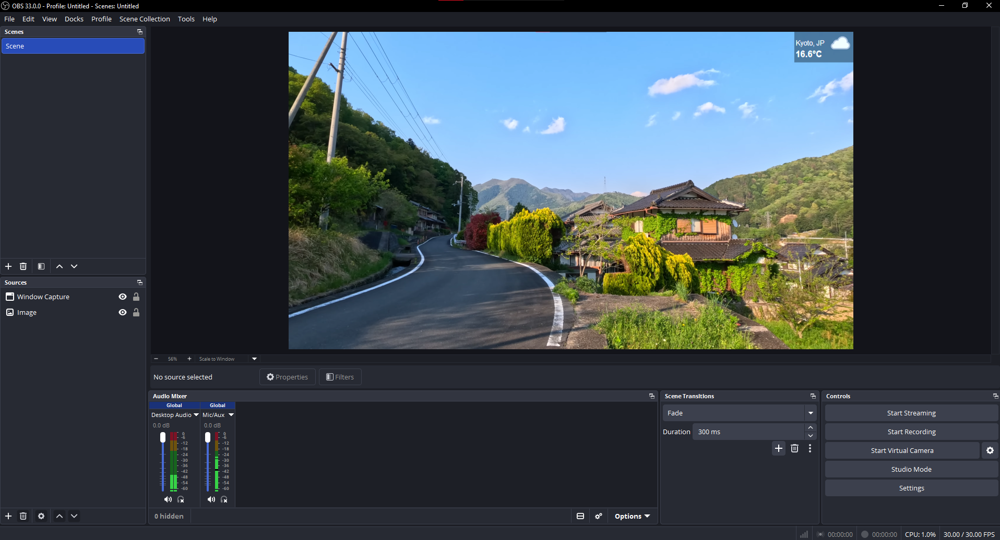
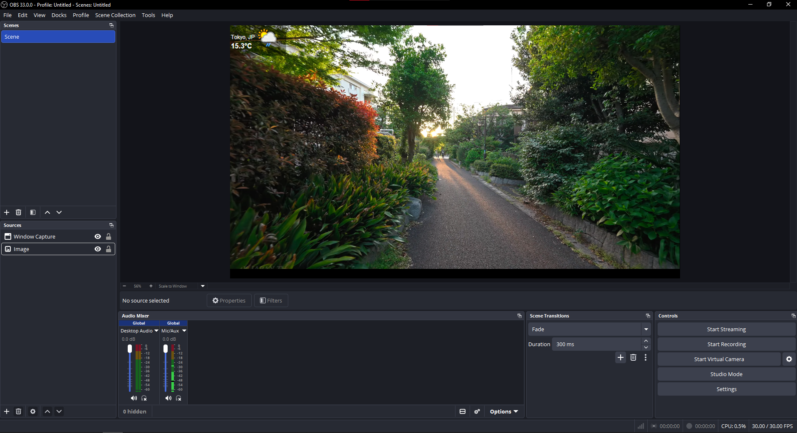
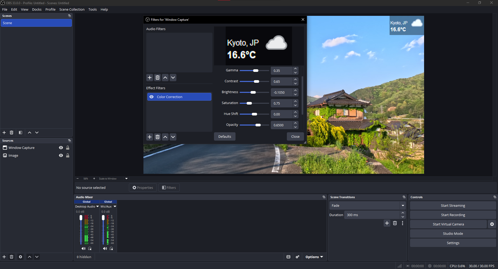

# IRLWeather

A lightweight weather overlay for IRL live streams.

IRLWeather is a desktop application built with Python that displays real-time weather information in a compact overlay. It is designed to be captured by streaming software such as OBS Studio, allowing streamers to display weather conditions directly on their broadcasts.

## Preview




## Features

- Current temperature display.
- Automatic location detection through the WeatherAPI.
- Country identification using ISO 3166-1 alpha-2 codes.
- Dynamic weather icons.
- Automatic weather updates every 5 minutes.
- Compact desktop overlay designed for OBS capture.
- Customizable window appearance.

## Built With

- Python
- Tkinter
- Requests
- Pillow
- PyCountry
- Python-dotenv
- [WeatherAPI](https://www.weatherapi.com/)

## Installation

### 1. Clone the repository

```bash
git clone https://github.com/claudioof/IRLWeather.git
cd IRLWeather
```

### 2. Install dependencies

```bash
pip install requests pycountry pillow python-dotenv
```

### 3. Configure your API key

Create a `.env` file in the project directory:

```env
WEATHER_API_KEY=your_api_key_here
```

Get your API key at [WeatherAPI](https://www.weatherapi.com/).

### 4. Run the application

```bash
python weather.py
```

Enter the name of the city when prompted.

## OBS Studio Setup

1. Run IRLWeather.
2. Open OBS Studio.
3. Add a **Window Capture** source.
4. Select the IRLWeather window.
5. Position and resize the overlay in your scene.

### Adjusting Overlay Opacity

To adjust the overlay transparency, use the settings inside OBS Studio rather than relying on the application's window opacity.

1. Right-click the IRLWeather Window Capture source.
2. Open **Filters**.
3. Add a **Color Correction** filter.
4. Adjust the **Opacity** setting to your preference.

The configuration below shows the settings used for my overlay:

